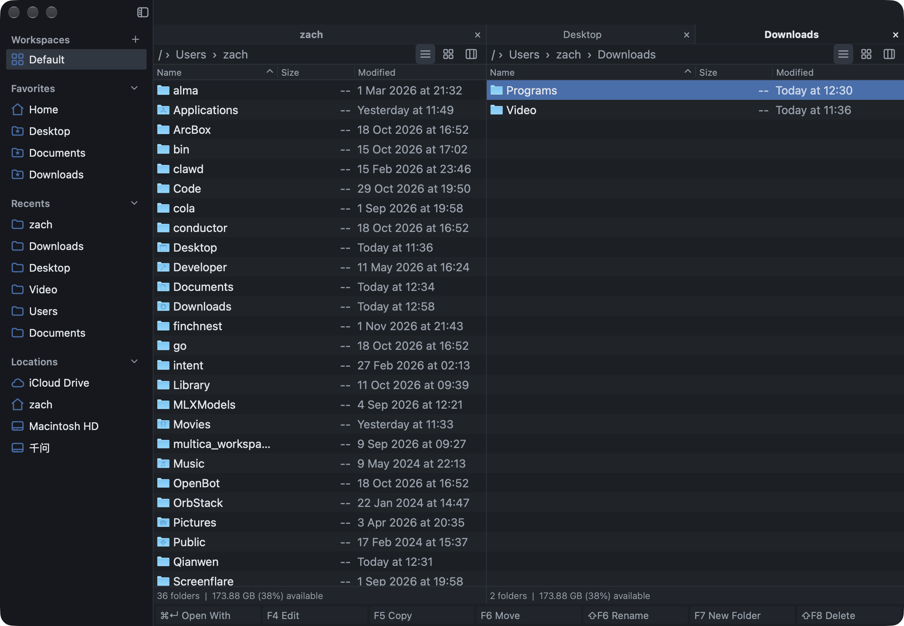

# Twintrail

[Website](https://zachzhao1984.github.io/twintrail/) · [Downloads](https://github.com/zachzhao1984/twintrail/releases/latest)

<p align="center">
  
</p>



A macOS native dual-pane file manager built on Go and myGO v0.7.3. Fully native UI, no WebView. Follows Marta's dual-pane navigation and shortcut habits, and performs real file operations.

## Implemented

- Directories first, name ascending or descending, hidden-file toggle, name substring filter. Each tab shows its folder as a list or as columns, the two buttons at the right end of the breadcrumb row switching, and the mode is saved with the tab.
- Each pane holds tabs: ⌘T opens one at the current folder, ⌘W closes it, and every tab also has a visible × button and a Close Tab context menu. A pane always keeps at least one tab; Shift+⌘W closes the window.
- Copy, move, rename, create nested directories, move to the macOS Trash (⌘⌫, at once, or F8, after a confirmation), with confirmation dialogs and error display. Entries drag between the panes, which moves them into the other pane's folder.
- File operations and directory reads run in the background; stale directory read results are discarded.
- Copy preserves symlinks, refuses to overwrite an existing target, and refuses to copy or move a directory into itself. Cross-volume moves currently show an error and do not fall back to copy and delete.
- Open with the system default application, Quick Look preview (Space toggles the system panel), reveal in Finder, external Terminal, native context menu. Pin to Favorites pins a folder to the sidebar from any view's menu, and Compress packs the entries into one zip beside them. The search box is hidden by default, shown with ⌘F or /. Copy Path writes the absolute paths of the marked entries to the pasteboard, one per line, each quoted so pasting into a terminal is safe.

## Appearance

The app is drawn in a light and a dark appearance, both built on one blue
accent: graphite panes in the dark look, white ones in the light, with the
sidebar, bands, rows and the terminal following. **View → Appearance** offers
**System**, which follows the system's own light and dark as it changes, and
**Light** and **Dark**, which pin one look; the choice is saved with the window
state, where a file written before System existed still reads as the look it
pinned. **View → Toggle ActionBar** hides the buttons along the window's foot,
and that is remembered too. The terminal at the bottom of a pane takes the same
palette, its blue and yellow being the app's accent and mark, and the line
above it drags to resize it.

## Icons

The app's own icons — the sidebar's home, folders, favourites, cloud and
disks, and the panes' list and columns — are drawings from [Kubai
Icons](https://icons.kubai.design/), MIT licensed, kept at `icons/` with the
licence beside them. Each was taken from the library's still pose and reduced
to what the app can tint: its outline, the faces it cuts, and its small detail
strokes, with the fills, gradients and shadow left out, so an icon takes the
colour of the row it sits in, in either appearance. Its four layout glyphs are
the same drawings reduced to their frame and centre lines, which is all that
survives at the 14 to 16 points a toolbar keeps for them. The disclosure
arrow, the plus above the workspaces and the magnifier of the search box stay
drawn here: a control that turns a quarter, a 12-point plus and a magnifier
smaller than the library's page-and-lens have no counterpart there.

## Sidebar and workspaces

A Finder-style sidebar sits to the left of the panes, in the manner of Tilde:

- **Jump to…**, with ⌘K, searches every folder on the machine for the active
  pane's tab: typing matches the whole path, ignoring case, and opens the
  chosen folder where the pane stands. Typing never walks the disk — the first
  use enumerates in the background, and later uses read memory and a private
  cache of directory paths. ⌘R inside the picker scans again, and the footer
  says when the index is still growing. `docs/folder-search.md` has the rest.
- **Workspaces** lists the saved layouts. The **+** at the right end of its
  header captures both panes as they are now: the tabs in each pane, the
  current tab, the active pane and the split position. Switching workspaces
  restores that layout; the layout being left is recorded first. Right-click a
  workspace to rename or delete it; the last workspace cannot be deleted.
- **Favorites** starts with Home, Desktop, Documents and Downloads. The
  sidebar's right edge drags to resize it, and the width is remembered. The
  button at the sidebar's top slides it away, and the one in the panes' strip
  brings it back.
- **Recents** keeps the last eight folders visited in either pane, newest
  first. The button at the right of the Favorites, Recents and Locations
  headers, or a click on the header itself, folds its items away over a
  moment and back.
- **Locations** lists iCloud Drive when present, the home folder and the
  mounted volumes.

Choosing a favorite, recent or location opens it in the active pane's current
tab. Right-click a favorite or recent to remove it from that list. Workspaces,
favorites and recents are saved in the window state file.

## Settings

The app menu **Settings…** (⌘,) opens a navigator over the nine fonts the window draws with: **File List**, **Column Headers**, **Path Bar**, **Pane Tabs**, **Status Bar**, **Workspaces**, **Action Bar**, **Terminal** and **Panel Text**. One region is edited at a time, under a preview of the parts that region sets — a list of rows, a line of headings, a path, tabs, the counts, the buttons along the foot, a terminal session — so a size being typed reads where it will land. The previews draw text and icons only: they take no keyboard from the editor and start nothing. Font names can be typed in directly, size range 8-48 pt. `Default` uses the system font (the Terminal uses the system monospace font), `Default Bold` and `Default Light` use the system bold and light fonts.

The sidebar's workspace names use Workspaces; the folder tabs at the top of each pane use Pane Tabs. Changes take effect immediately and the related row heights follow the size; the panel's own text can be changed too, while its navigator and controls keep the system font. Escape and Done close it, and Done returns the keyboard to the active pane. The user's given default font setup can be restored in one click. Settings save automatically to the `fonts` field of the window state file, with no restart and no "Apply" click.

## Open With

⌘Return opens the application chooser, which queries the available applications for the selected files through the native macOS NSWorkspace. It includes the default application and the "All Applications…" system picker. With multiple files selected, it shows the applications all of them support.

Application names appear first and are immediately selectable, icons render in the background as 64×64 bitmaps. The application list is cached per selected path for one minute, showing the cache first and refreshing in the background when it expires; icons are cached per application path, so reopening does not start a script or convert an icon again.

## Embedded terminal

**View → Toggle Terminal** (⌘`) shows or hides the terminal of the current tab. The panel sits at the bottom of the window and uses myGO's native Ghostty terminal plugin.

Each tab keeps its own zsh login shell and scrollback history; hiding it does not end the session, closing the tab or the window releases it. When switching tabs or the active pane, the bottom shows that tab's terminal state.

After navigation succeeds, that tab's terminal CWD is synced. The sync uses a separate notification channel and does not inject a `cd` command into the terminal input stream; while a command is running, the sync waits for it to finish and keeps any typed but uncommitted command. Supports directory names with spaces and quotes. The sync is one-way, from the file panel to the terminal.

Packaging automatically fetches and signs `libghostty-vt`; a development environment needs to download the library on first run, and `MYGO_GHOSTTY_VT` can point at an already downloaded copy.

## Development

```sh
go install github.com/egoist/mygo/cmd/mygo@latest
go tool mygo dev
go tool mygo vet
```

To build the macOS app:

```sh
go tool mygo build --skip-dmg
open build/darwin-arm64/Twintrail.app
```

Tests cover the native UI lifecycle, focus and shortcuts, marking, hidden files, directory creation, copy move rename, overwrite and recursive target validation, sidebar navigation, workspace layout recall, as well as terminal toggle, separate sessions, directory sync, and close cleanup.